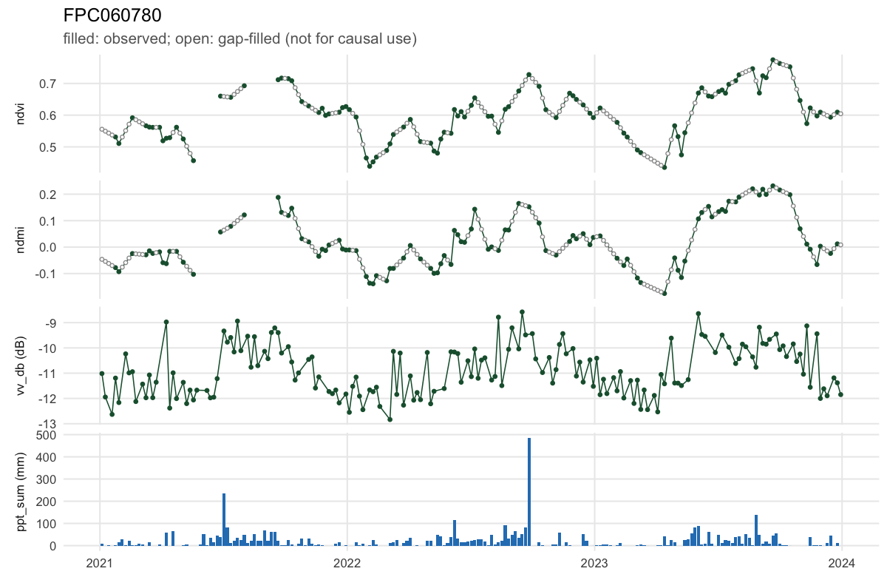
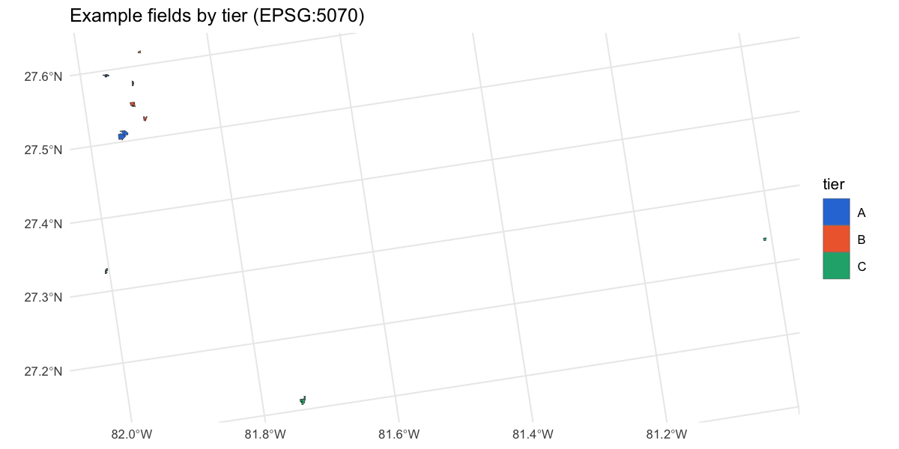
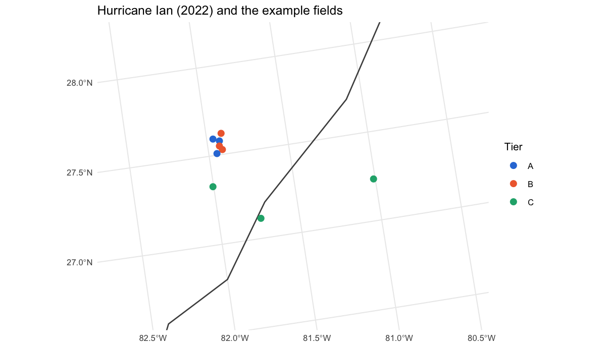
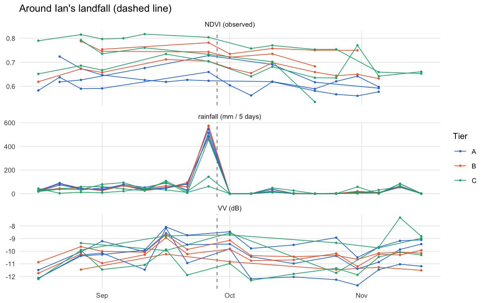
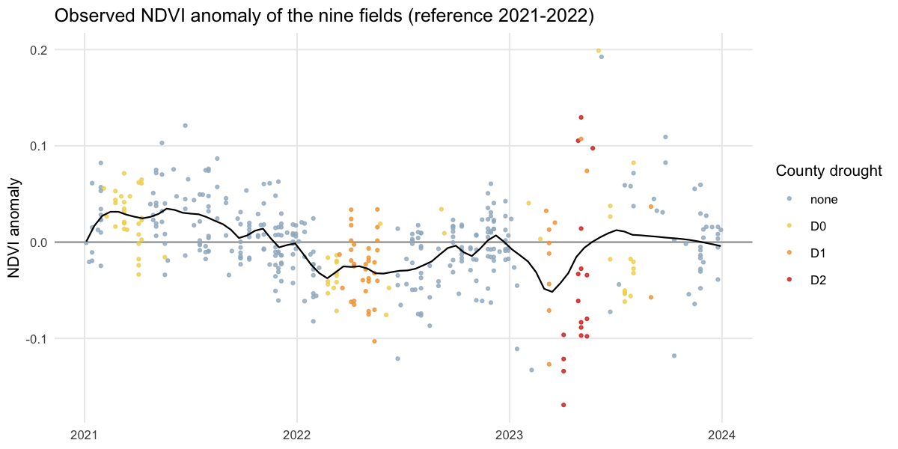
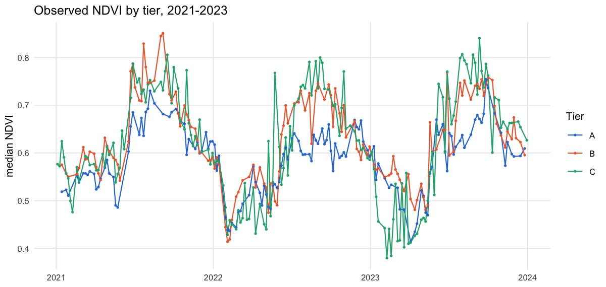
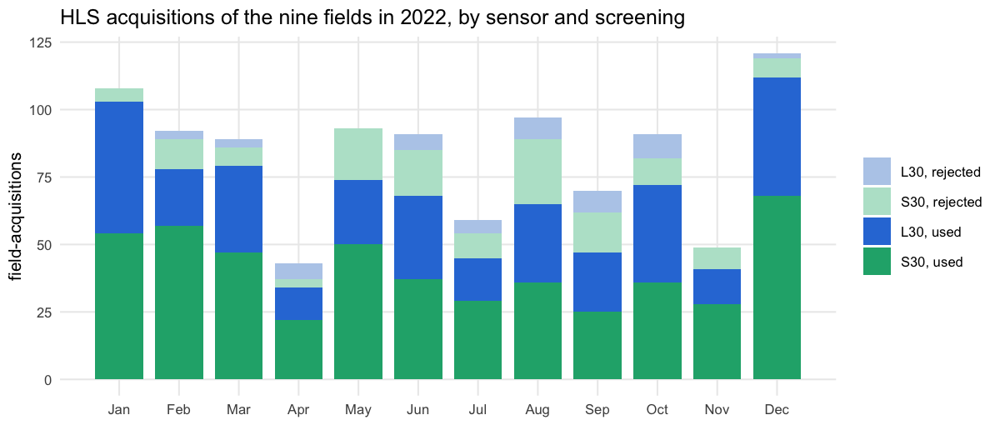
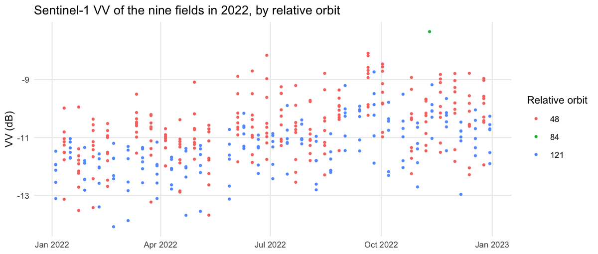
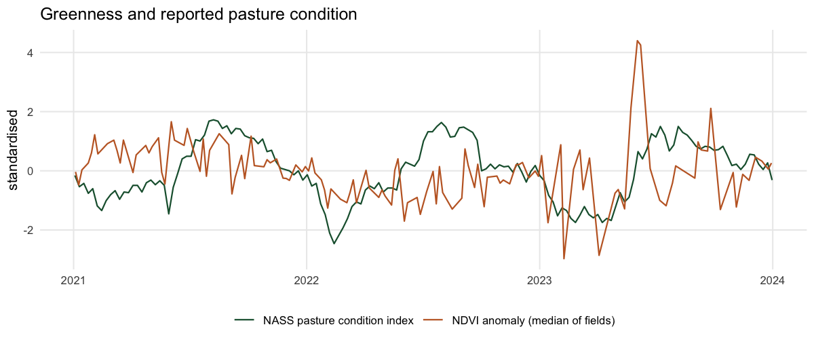

<!-- README.md is generated from README.Rmd. Edit README.Rmd and run rmarkdown::render("README.Rmd"). -->

# fpcubeR

[](https://doi.org/10.5281/zenodo.24542431)
[](LICENSE.md)

`fpcubeR` downloads and reads the **Florida Pasture Cube** in R.

The Florida Pasture Cube describes **62,847 persistent pasture fields in
Florida** (0.98 million ha) every 5 days from January 2016 to October
2026. For each field it holds:

- **Optical:** Harmonized Landsat and Sentinel-2 (HLS) reflectance and
  five spectral indices.
- **Radar:** Sentinel-1 backscatter.
- **Weather:** PRISM daily weather.
- **Field attributes:** soil, terrain and wetland attributes.
- **Labels:** county drought, state pasture condition and hurricane
  records.

Every composite can be traced to the satellite acquisitions it came
from.

The package turns this into ordinary R data frames and `sf` objects. Its
functions select fields, read time series and remove gap-filled values
unless you ask for them. They also join the drought map, compute
anomalies against each field’s own climatology, and plot fields and
series.

|  |  |
|----|----|
| Data | Zenodo, [10.5281/zenodo.24542431](https://doi.org/10.5281/zenodo.24542431), CC BY 4.0 |
| Processing code (Python) | [github.com/HugoMachadoRodrigues/fpcube](https://github.com/HugoMachadoRodrigues/fpcube), [10.5281/zenodo.24542304](https://doi.org/10.5281/zenodo.24542304) |
| This package | MIT licence |

## Contents

- [Installation](#installation)
- [Quick start](#quick-start)
- [The data in one page](#the-data-in-one-page)
- [Functions](#functions)
  - [Getting the data](#getting-the-data)
  - [Reading](#reading)
  - [Analysis helpers](#analysis-helpers)
  - [Plots](#plots)
- [Worked examples](#worked-examples)
- [Good practice](#good-practice)
- [Citation](#citation)

## Installation

``` r
# install.packages("remotes")
remotes::install_github("HugoMachadoRodrigues/fpcubeR")
```

The package needs `arrow`, `sf`, `dplyr`, `curl`, `jsonlite` and
`rlang`. `ggplot2` is needed only for the plots, and `digest` only for
`fpc_verify()`.

## Quick start

``` r
library(fpcubeR)

# 1. Download the fields, the 5-day composites of 2022 and the labels (about 230 MB)
fpc_download(c("fields", "composites", "labels"), years = 2022)

# 2. Pick fields: tier A (parcels coded as grazing land) in Hardee County
f <- fpc_fields(tier = "A", county = "Hardee")

# 3. Read their NDVI, Sentinel-1 VV backscatter and rainfall, observed values only
x <- fpc_composites(f, vars = c("ndvi", "vv_db", "ppt_sum"), years = 2022)

# 4. Plot one field
fpc_plot_field(f$field_id[1], years = 2022)
```

Every example below runs on a **small real extract** shipped with the
package. It holds nine fields, three of each tier, from Hardee, DeSoto
and Highlands counties. Composites cover 2021–2023, and observations and
labels cover 2022. `fpc_example_dir()` points to it, so you can run the
examples without downloading anything. With the full data, drop the
`dir = d` argument.

``` r
library(fpcubeR)
d <- fpc_example_dir()
```

## The data in one page

**Fields.** A field is a connected part of persistent pasture inside one
tax parcel, of at least 2 ha.

| Tier | Definition | Fields | Area |
|----|----|----|----|
| A | on parcels coded as grazing land | 41,976 | 745 kha |
| B | on other parcels, mapped as pasture in nearly every year | 10,073 | 133 kha |
| C | open pasture in the official land-use maps (FLUCCS) that the Cropland Data Layer maps as woody or wetland | 10,798 | 102 kha |

For a conservative set of grazing fields use tier A. Tier C contains
wetter pastures. Owner information is never downloaded, and parcel
identifiers are not distributed.

**Calendar.** Composites cover 5-day periods anchored on 1 January 2016,
791 periods to 29 October 2026. `date` is the first day of a period.

**Composites.** Each variable is a column, in four groups:

- **Optical:** HLS reflectance (blue to SWIR-2), NDVI, EVI, NDMI, MNDWI,
  NBR, the within-field NDVI standard deviation and the water fraction.
- **Counts:** `n_optical_obs`, `gap_filled` and `n_radar_obs`.
- **Radar:** Sentinel-1 VV, VH and VH−VV in dB.
- **Weather:** PRISM 5-day rainfall, mean, minimum and maximum
  temperature, and maximum vapour-pressure deficit.

**Gap-filling.** Optical gaps of up to 30 days are filled by linear
interpolation and flagged. An interpolated value uses the next
observation, so it must not be used in forecasts or any analysis that
has to be causal. `fpc_composites()` sets these values to `NA` by
default.

**Files on Zenodo.**

| Part (`fpc_download(what = )`) | File(s) | Size |
|----|----|----|
| `"fields"` | `fields.parquet` | 27 MB |
| `"composites"` | `composites_2016.parquet` … `composites_2026.parquet` | about 200 MB per year |
| `"labels"` | `labels.zip` → `labels/*.parquet` | \< 1 MB |
| `"optical"` | `optical_observations.zip` → one Parquet file per year | 4.0 GB |
| `"radar"` | `radar_observations.zip` → one Parquet file per year | 1.0 GB |
| `"lineage"`, `"validation"`, `"benchmark"`, `"stac"`, `"docs"` | identifiers across versions, validation tables, benchmark, STAC catalog, datasheet and checksums | small |
| `"cube"` | `cube.zarr.zip`, the same composites as a Zarr store, for Python | 2.5 GB |

## Functions

| Function | What it does |
|----|----|
| `fpc_download()` | downloads parts of the data set from Zenodo, checks the checksums and unpacks them |
| `fpc_files()` | lists the files of the Zenodo record with sizes and checksums |
| `fpc_dir()`, `fpc_set_dir()` | the folder where the data are kept |
| `fpc_verify()` | checks the downloaded files against the release SHA-256 checksums |
| `fpc_example_dir()` | the small example shipped with the package |
| `fpc_fields()` | fields as an `sf` object, filtered by tier, county or identifier |
| `fpc_variables()` | name, group, units and description of every composite variable |
| `fpc_composites()` | 5-day time series, wide or long, observed values only by default |
| `fpc_observations()` | per-acquisition optical (HLS) or radar (Sentinel-1) records |
| `fpc_labels()` | US Drought Monitor, NASS pasture condition, hurricane tracks and landfalls |
| `fpc_add_drought()` | adds the county drought class valid on each date |
| `fpc_climatology()`, `fpc_anomaly()` | each field’s own seasonal climatology and the anomaly from it |
| `fpc_summarise()` | median (or another statistic) over fields for each date |
| `fpc_plot_field()` | time-series panels of one field |
| `fpc_map_fields()` | map of field polygons coloured by a column |

### Getting the data

#### `fpc_download()`

`fpc_download()` downloads the parts you ask for from the Zenodo record
into the data folder:

- It checks the MD5 checksum of every file.
- It unpacks the zipped folders, so the data folder has the same layout
  as the release.
- It skips files that are already present and intact, so running it
  again only completes what is missing.

The default downloads the fields, all composites and the labels. Use
`years` to download only some years of the composites.

``` r
fpc_download()                                                # fields + all composites + labels (~2.4 GB)
fpc_download(c("fields", "composites"), years = 2020:2022)    # three years only
fpc_download("optical")                                       # per-acquisition HLS records (4 GB)
fpc_download("docs")                                          # DATASHEET.md and checksums
```

#### `fpc_files()`

`fpc_files()` lists what is on Zenodo before you download it: file,
group, size, MD5 and URL.

``` r
f <- fpc_files()
f[f$group %in% c("fields", "composites"), c("file", "size_mb")]
```

#### `fpc_dir()` and `fpc_set_dir()`

All readers look for the data in one folder. They check these places, in
this order:

1.  the folder set with `fpc_set_dir()` in the current session;
2.  the environment variable `FPCUBE_DIR` (for example in your
    `.Renviron`);
3.  `tools::R_user_dir("fpcubeR", "data")`.

Every reader also takes `dir =` to point to another folder.

``` r
old <- fpc_set_dir(d)   # use the example folder for this session
fpc_dir()
#> [1] "/Users/rodrigues.h/Library/R/arm64/4.6/library/fpcubeR/extdata/fpcube_example"
fpc_set_dir(old)        # back to the previous setting
```

#### `fpc_verify()`

`fpc_verify()` compares each downloaded file with the SHA-256 checksum
of the release (`SHA256SUMS`, part `"docs"`). It needs the `digest`
package.

``` r
fpc_download("docs")
v <- fpc_verify()
all(v$ok[v$present])
```

### Reading

#### `fpc_fields()`

`fpc_fields()` reads `fields.parquet` and returns an `sf` object. The
geometry is in EPSG:5070 (CONUS Albers, metres). You can filter by
`tier`, `county` (case-insensitive, with or without “County”) or field
identifier, and choose the columns. With `geometry = FALSE` you get a
plain data frame, which is faster.

``` r
f <- fpc_fields(dir = d)
f[, c("field_id", "tier", "county", "area_ha", "hand_mean_m", "drainage_class")]
#> Simple feature collection with 9 features and 6 fields
#> Geometry type: POLYGON
#> Dimension:     XY
#> Bounding box:  xmin: 1386915 ymin: 555975 xmax: 1487055 ymax: 609495
#> Projected CRS: NAD83 / Conus Albers
#>    field_id tier    county area_ha hand_mean_m          drainage_class                       geometry
#> 1 FPC059432    B    Hardee    8.28   8.0297442 Somewhat poorly drained POLYGON ((1392525 609495, 1...
#> 2 FPC060780    A    Hardee   16.65   0.9626154          Poorly drained POLYGON ((1387455 605895, 1...
#> 3 FPC061123    A    Hardee   10.53   0.6225764          Poorly drained POLYGON ((1391325 604905, 1...
#> 4 FPC061831    B    Hardee   34.83   1.1661365          Poorly drained POLYGON ((1391475 601725, 1...
#> 5 FPC062581    B    Hardee   20.97   0.8724991          Poorly drained POLYGON ((1393035 599535, 1...
#> 6 FPC062877    A    Hardee  115.74   1.7260204          Poorly drained POLYGON ((1390095 597435, 1...
#> 7 FPC094408    C Highlands   15.48   0.5854164          Poorly drained POLYGON ((1486815 581205, 1...
#> 8 FPC094588    C    DeSoto   14.94   1.2259987          Poorly drained POLYGON ((1387515 576585, 1...
#> 9 FPC095347    C    DeSoto   49.95   1.0317036          Poorly drained POLYGON ((1417245 557295, 1...
```

The main columns are:

- **Identity:** `field_id` and `fid` (the same identifier as text and as
  an integer), `tier`, `county`, `county_fips`, the parcel use code
  `dor_use_code` and `ag_exempt`.
- **Shape:** `area_ha`, `perimeter_m`, `compactness`, `n_parts` and the
  pixel counts.
- **Land-cover history:** `pasture_frac_2016` … `pasture_frac_2025`, the
  Cropland Data Layer pasture fraction of each year.
- **Soil:** majority map unit, AWS, SOC, drainage class, flooding,
  hydrologic group and water-table depth.
- **Terrain:** elevation, slope, TWI and HAND.
- **Wetlands:** wetland fraction in the field and in a 500 m ring.
- **Quality flags:** `flag_few_interior`, `flag_landuse_change`,
  `flag_no_optical` and `flag_no_observations`.

`DATASHEET.md`, part `"docs"`, documents every column.

``` r
fpc_fields(tier = "C", geometry = FALSE, dir = d)[, c("field_id", "county", "area_ha", "pasture_years_mean")]
#>    field_id    county area_ha pasture_years_mean
#> 1 FPC094408 Highlands   15.48           5.052326
#> 2 FPC094588    DeSoto   14.94           3.132530
#> 3 FPC095347    DeSoto   49.95           1.209009
nrow(fpc_fields(county = "Hardee", geometry = FALSE, dir = d))
#> [1] 6
```

#### `fpc_variables()`

`fpc_variables()` lists the variables of the composites with their
group, units and description. They are read from the metadata stored in
the Parquet files.

``` r
v <- fpc_variables(d)
v[, c("name", "group", "units")]
#>             name   group units
#> 1           blue optical     1
#> 2          green optical     1
#> 3            red optical     1
#> 4            nir optical     1
#> 5          swir1 optical     1
#> 6          swir2 optical     1
#> 7           ndvi optical     1
#> 8            evi optical     1
#> 9           ndmi optical     1
#> 10         mndwi optical     1
#> 11           nbr optical     1
#> 12       ndvi_sd optical     1
#> 13    water_frac optical     1
#> 14 n_optical_obs   count     1
#> 15    gap_filled   count      
#> 16   n_radar_obs   count     1
#> 17         vv_db   radar    dB
#> 18         vh_db   radar    dB
#> 19      vh_vv_db   radar    dB
#> 20       ppt_sum weather    mm
#> 21    tmean_mean weather  degC
#> 22     tmin_mean weather  degC
#> 23     tmax_mean weather  degC
#> 24   vpdmax_mean weather   hPa
```

#### `fpc_composites()`

`fpc_composites()` reads the 5-day composites. You can choose the fields
(identifiers or the result of `fpc_fields()`), the variables, the years
or a date range with `from` and `to`. The result has one row per field
and period. With `long = TRUE` it has one row per field, period and
variable, which suits `ggplot2` and `tidyr`.

The files are sorted by field and date, so a selection of fields reads
only a small part of each file.

``` r
x <- fpc_composites(f, vars = c("ndvi", "vv_db", "ppt_sum"), years = 2022, dir = d)
head(x)
#>    field_id   fid       date      ndvi     vv_db ppt_sum n_optical_obs gap_filled n_radar_obs
#> 1 FPC059432 59432 2022-01-04 0.5673187       NaN  0.0000             2      FALSE           0
#> 2 FPC059432 59432 2022-01-09        NA -11.51026  0.0000             0       TRUE           1
#> 3 FPC059432 59432 2022-01-14 0.5754479       NaN 13.9515             2      FALSE           0
#> 4 FPC059432 59432 2022-01-19        NA -12.71441  0.4209             0       TRUE           1
#> 5 FPC059432 59432 2022-01-24        NA       NaN  9.8918             0       TRUE           0
#> 6 FPC059432 59432 2022-01-29 0.3857892       NaN  0.0000             2      FALSE           0
```

**Observed versus gap-filled values.** The default
`observed_only = TRUE` sets the optical values of gap-filled periods to
`NA` (`n_optical_obs == 0`) and keeps radar and weather. Set it to
`FALSE` to see what the release fills in:

``` r
all <- fpc_composites(f, vars = "ndvi", years = 2022, observed_only = FALSE, dir = d)
c(periods = nrow(all), observed = sum(all$n_optical_obs > 0), gap_filled = sum(all$gap_filled),
  empty = sum(is.na(all$ndvi)))
#>    periods   observed gap_filled      empty 
#>        657        364        293          0
```

Long format and a date range:

``` r
fpc_composites(f$field_id[1], vars = c("ndvi", "ndmi"), from = "2022-04-01", to = "2022-04-30",
               long = TRUE, dir = d)
#>     field_id   fid       date n_optical_obs gap_filled n_radar_obs variable         value
#> 1  FPC059432 59432 2022-04-04             2      FALSE           1     ndvi  0.6203476787
#> 2  FPC059432 59432 2022-04-04             2      FALSE           1     ndmi  0.0227821749
#> 3  FPC059432 59432 2022-04-09             0       TRUE           0     ndvi            NA
#> 4  FPC059432 59432 2022-04-09             0       TRUE           0     ndmi            NA
#> 5  FPC059432 59432 2022-04-14             0       TRUE           1     ndvi            NA
#> 6  FPC059432 59432 2022-04-14             0       TRUE           1     ndmi            NA
#> 7  FPC059432 59432 2022-04-19             1      FALSE           0     ndvi  0.5879856944
#> 8  FPC059432 59432 2022-04-19             1      FALSE           0     ndmi -0.0005994197
#> 9  FPC059432 59432 2022-04-24             0       TRUE           0     ndvi            NA
#> 10 FPC059432 59432 2022-04-24             0       TRUE           0     ndmi            NA
#> 11 FPC059432 59432 2022-04-29             2      FALSE           1     ndvi  0.5261331797
#> 12 FPC059432 59432 2022-04-29             2      FALSE           1     ndmi -0.0720881075
```

#### `fpc_observations()`

`fpc_observations()` reads the records behind the composites, one row
per field and acquisition.

- **Optical (HLS):** sensor (`L30` Landsat, `S30` Sentinel-2), MGRS
  tile, granule, clear and total field pixels, field-mean reflectance
  and indices, the estimated geometric shift and the quality flags. By
  default it keeps only the records that enter the composites
  (`qa_use`). Set `usable_only = FALSE` to see the rejected ones too.
- **Radar (Sentinel-1):** linear and dB backscatter, platform, pass
  direction and relative orbit.

``` r
o <- fpc_observations("optical", fields = f$field_id[1:3], years = 2022, dir = d)
head(o[, c("field_id", "date", "sensor", "tile", "n_clear_px", "ndvi", "shift_px", "qa_geometry_status")])
#>    field_id                date sensor   tile n_clear_px      ndvi   shift_px qa_geometry_status
#> 1 FPC059432 2022-01-03 16:15:45    S30 T17RML         62 0.5895447 0.06381669               pass
#> 2 FPC059432 2022-01-07 15:56:04    L30 T17RML         62 0.5713150 0.03156833               pass
#> 3 FPC059432 2022-01-08 16:15:39    S30 T17RML         62 0.5633226 0.03516155               pass
#> 4 FPC059432 2022-01-15 15:56:02    L30 T17RML         62 0.5702903 0.02849783               pass
#> 5 FPC059432 2022-01-18 16:15:38    S30 T17RML         62 0.5806054 0.02295711               pass
#> 6 FPC059432 2022-01-31 15:55:57    L30 T17RML         62 0.3914838 0.05679911               pass
table(o$sensor)
#> 
#> L30 S30 
#> 100 153

r <- fpc_observations("radar", fields = f$field_id[1], years = 2022, dir = d)
head(r[, c("field_id", "date", "platform", "orbit_state", "relative_orbit", "vv_db", "vh_db")])
#>    field_id                date    platform orbit_state relative_orbit     vv_db     vh_db
#> 1 FPC059432 2022-01-11 23:28:50 SENTINEL-1A   ascending             48 -11.51026 -16.35783
#> 2 FPC059432 2022-01-23 23:28:49 SENTINEL-1A   ascending             48 -12.71441 -17.34947
#> 3 FPC059432 2022-02-04 23:28:49 SENTINEL-1A   ascending             48 -11.27288 -16.12125
#> 4 FPC059432 2022-02-16 23:28:49 SENTINEL-1A   ascending             48 -11.80129 -17.13959
#> 5 FPC059432 2022-03-12 23:28:49 SENTINEL-1A   ascending             48 -10.98435 -18.27854
#> 6 FPC059432 2022-03-24 23:28:49 SENTINEL-1A   ascending             48 -11.11576 -17.64979
```

#### `fpc_labels()`

`fpc_labels()` reads one of the label tables:

- `"usdm"`: the US Drought Monitor for each county and week, as the
  percent of area in D0–D4 (cumulative), the dominant class and the
  DSCI.
- `"nass"`: the weekly NASS pasture condition for Florida, from very
  poor to excellent, with a condition index.
- `"tracks"`: the six-hourly positions of every storm within 3° of
  Florida.
- `"landfalls"`: the Florida landfalls.

Times are in UTC. Landfalls of storms not yet in HURDAT2 are derived
from the track, and their `source` column says so.

``` r
head(fpc_labels("nass", d), 3)
#>   week_ending very_poor poor fair good excellent condition_index
#> 1  2016-01-03         2   11   35   46         6            3.43
#> 2  2016-01-10         2   14   34   45         5            3.37
#> 3  2016-01-17         2   16   34   43         5            3.33
lf <- fpc_labels("landfalls", d)
lf[lf$name %in% c("IRMA", "IAN", "MILTON"), c("name", "time", "status", "lat", "lon", "vmax_kt", "source")]
#>       name                time status  lat   lon vmax_kt  source
#> 16    IRMA 2017-09-06 05:45:00     HU 17.7 -61.8     155 HURDAT2
#> 17    IRMA 2017-09-06 11:15:00     HU 18.1 -63.1     155 HURDAT2
#> 18    IRMA 2017-09-06 16:30:00     HU 18.5 -64.4     155 HURDAT2
#> 19    IRMA 2017-09-08 05:00:00     HU 21.5 -73.0     135 HURDAT2
#> 20    IRMA 2017-09-09 03:00:00     HU 22.3 -77.9     145 HURDAT2
#> 21    IRMA 2017-09-10 13:00:00     HU 24.7 -81.5     115 HURDAT2
#> 22    IRMA 2017-09-10 19:30:00     HU 25.9 -81.7     100 HURDAT2
#> 83     IAN 2022-09-27 08:30:00     HU 22.2 -83.7     110 HURDAT2
#> 84     IAN 2022-09-28 02:00:00     HU 24.6 -82.9     110 HURDAT2
#> 85     IAN 2022-09-28 19:05:00     HU 26.7 -82.2     130 HURDAT2
#> 86     IAN 2022-09-28 20:35:00     HU 26.8 -82.0     125 HURDAT2
#> 87     IAN 2022-09-30 18:05:00     HU 33.3 -79.2      70 HURDAT2
#> 104 MILTON 2024-10-10 00:30:00     HU 27.4 -82.6     100 HURDAT2
```

### Analysis helpers

#### `fpc_add_drought()`

`fpc_add_drought()` adds the US Drought Monitor map of the field’s
county that was valid on each date:

- `usdm_class`: 0 none, 1 D0, 2 D1, 3 D2, 4 D3, 5 D4. It is the highest
  category that covers at least half of the county.
- `usdm_d1_pct`: the percent of the county in D1 or worse.
- `dsci`: the Drought Severity and Coverage Index, from 0 to 500.

``` r
xd <- fpc_add_drought(x, dir = d)
table(class = xd$usdm_class)
#> class
#>   0   1   2 
#> 460  68 129
```

#### `fpc_climatology()` and `fpc_anomaly()`

`fpc_climatology()` computes the mean of a variable for each field and
each 5-day period of the year (1 to 73) over the reference years. It
uses only the values present, so read the composites with
`observed_only = TRUE`. With `min_years` set, a period with fewer
observed years gets `NA`.

`fpc_anomaly()` adds `period`, `clim` and `anomaly` (the value minus the
climatology) to the data.

``` r
x3 <- fpc_composites(f, vars = "ndvi", dir = d)                 # 2021-2023
a <- fpc_anomaly(x3, "ndvi", ref_years = 2021:2022, min_years = 2)
head(a[!is.na(a$anomaly), c("field_id", "date", "ndvi", "period", "clim", "anomaly")])
#>     field_id       date      ndvi period      clim    anomaly
#> 6  FPC059432 2021-01-29 0.5503409      6 0.4680651 0.08227584
#> 14 FPC059432 2021-03-10 0.6120253     14 0.5773032 0.03472212
#> 24 FPC059432 2021-04-29 0.5824865     24 0.5543098 0.02817664
#> 25 FPC059432 2021-05-04 0.5599563     25 0.5437452 0.01621106
#> 35 FPC059432 2021-06-23 0.7712651     35 0.7265847 0.04468045
#> 41 FPC059432 2021-07-23 0.8289607     41 0.7796170 0.04934371
```

#### `fpc_summarise()`

`fpc_summarise()` computes the median (or any function you pass as
`fun`) over fields for each date, with the number of fields that have a
value. Use `by =` for groups, such as tiers.

``` r
a$tier <- f$tier[match(a$field_id, f$field_id)]
s <- fpc_summarise(a, "anomaly", by = "tier")
head(s)
#>           date tier         value n_fields
#> 146 2021-01-04    C -0.0006985068        1
#> 147 2021-01-09    C -0.0205351710        1
#> 1   2021-01-14    A -0.0106441379        1
#> 81  2021-01-14    B -0.0193745196        1
#> 148 2021-01-14    C  0.0382368267        2
#> 149 2021-01-24    C  0.0127793550        1
```

### Plots

#### `fpc_plot_field()`

`fpc_plot_field()` draws one panel per variable for one field:

- observed optical values as points joined by a line;
- gap-filled values as open circles;
- rainfall as bars.

``` r
fpc_plot_field("FPC060780", vars = c("ndvi", "ndmi", "vv_db", "ppt_sum"), years = 2021:2023, dir = d)
```



#### `fpc_map_fields()`

`fpc_map_fields()` maps the field polygons, coloured by any column, by
default the tier.

``` r
fpc_map_fields(f) + ggplot2::labs(title = "Example fields by tier (EPSG:5070)")
```



## Worked examples

### 1. Hurricane Ian over the example fields

Hurricane Ian made landfall in south-west Florida on 28 September 2022
and crossed Hardee and DeSoto counties. The map draws its six-hourly
track on top of the example fields.

``` r
tr <- fpc_labels("tracks", d)
ian <- tr[tr$name == "IAN" & format(tr$time, "%Y") == "2022", ]
ian_line <- sf::st_sfc(sf::st_linestring(as.matrix(ian[, c("lon", "lat")])), crs = 4326)
ian_line <- sf::st_transform(ian_line, 5070)
box <- sf::st_bbox(sf::st_buffer(sf::st_union(f), 60000))
cen <- sf::st_sf(tier = f$tier, geometry = sf::st_centroid(sf::st_geometry(f)))
ggplot() +
  geom_sf(data = ian_line, colour = "grey30", linewidth = 0.6) +
  geom_sf(data = cen, aes(colour = tier), size = 2.5) +
  scale_colour_manual(values = c(A = "#2f7bd9", B = "#ef6a3a", C = "#1fae7a")) +
  coord_sf(xlim = box[c(1, 3)], ylim = box[c(2, 4)]) +
  labs(title = "Hurricane Ian (2022) and the example fields", colour = "Tier")
```



Rainfall, VV backscatter and observed NDVI of the nine fields around the
landfall. Ian brought more than 200 mm in a few days. Its effect on the
composites is short-lived and small, as the paper describes.

``` r
xi <- fpc_composites(f, vars = c("ppt_sum", "vv_db", "ndvi"), from = "2022-08-15", to = "2022-11-15",
                     long = TRUE, dir = d)
xi$tier <- f$tier[match(xi$field_id, f$field_id)]
ggplot(xi[!is.na(xi$value), ], aes(date, value, group = field_id, colour = tier)) +
  geom_vline(xintercept = as.Date("2022-09-28"), linetype = 2, colour = "grey50") +
  geom_line(linewidth = 0.4) + geom_point(size = 0.7) +
  facet_wrap(~variable, ncol = 1, scales = "free_y",
             labeller = as_labeller(c(ppt_sum = "rainfall (mm / 5 days)", vv_db = "VV (dB)",
                                      ndvi = "NDVI (observed)"))) +
  scale_colour_manual(values = c(A = "#2f7bd9", B = "#ef6a3a", C = "#1fae7a")) +
  labs(x = NULL, y = NULL, colour = "Tier", title = "Around Ian's landfall (dashed line)")
```



### 2. Greenness anomaly and county drought

This example computes each field’s NDVI anomaly against its own
2021–2022 climatology. It then colours every observation by the county
drought class of that week.

``` r
ad <- fpc_add_drought(a, dir = d)
ad <- ad[!is.na(ad$anomaly), ]
ad$drought <- factor(ad$usdm_class, levels = 0:5, labels = c("none", "D0", "D1", "D2", "D3", "D4"))
ggplot(ad, aes(date, anomaly)) +
  geom_hline(yintercept = 0, colour = "grey60") +
  geom_point(aes(colour = drought), size = 0.8, alpha = 0.8) +
  geom_smooth(se = FALSE, colour = "black", linewidth = 0.5, span = 0.15, method = "loess", formula = y ~ x) +
  scale_colour_manual(values = c(none = "#9fb7c9", D0 = "#f2d45c", D1 = "#f1a340", D2 = "#d7301f",
                                 D3 = "#7f0000", D4 = "#3b0000"), drop = TRUE) +
  labs(x = NULL, y = "NDVI anomaly", colour = "County drought",
       title = "Observed NDVI anomaly of the nine fields (reference 2021-2022)")
```



### 3. The seasonal cycle by tier

Median observed NDVI over the fields of each tier and date. Tier C, open
pasture that the Cropland Data Layer labels as woody or wetland, is
wetter and stays greener in the dry spring.

``` r
x3$tier <- f$tier[match(x3$field_id, f$field_id)]
st <- fpc_summarise(x3, "ndvi", by = "tier")
ggplot(st, aes(date, value, colour = tier)) +
  geom_line(linewidth = 0.5) + geom_point(size = 0.6) +
  scale_colour_manual(values = c(A = "#2f7bd9", B = "#ef6a3a", C = "#1fae7a")) +
  labs(x = NULL, y = "median NDVI", colour = "Tier", title = "Observed NDVI by tier, 2021-2023")
```



### 4. Where the observations come from

The per-acquisition table shows which sensor observed each field and
when. It also shows how the clear sky of the dry season and the clouds
of the wet season (June–September) shape the record.

``` r
oa <- fpc_observations("optical", years = 2022, usable_only = FALSE, dir = d)
oa$use <- ifelse(oa$qa_use, "used", "rejected")
oa$month <- as.integer(format(oa$date, "%m"))
ggplot(oa, aes(month, fill = interaction(sensor, use, sep = ", "))) +
  geom_bar(width = 0.8) +
  scale_x_continuous(breaks = 1:12, labels = month.abb) +
  scale_fill_manual(values = c("L30, used" = "#2f7bd9", "S30, used" = "#1fae7a",
                               "L30, rejected" = "#b7cdea", "S30, rejected" = "#b8e3d0")) +
  labs(x = NULL, y = "field-acquisitions", fill = NULL,
       title = "HLS acquisitions of the nine fields in 2022, by sensor and screening")
```



### 5. Radar backscatter by relative orbit

Sentinel-1 views a field from different relative orbits, so the
incidence angle changes. Compare the backscatter within one orbit, or
normalise it by orbit, before you read changes between dates.

``` r
ra <- fpc_observations("radar", years = 2022, dir = d)
ra$orbit <- factor(ra$relative_orbit)
ggplot(ra, aes(as.Date(date), vv_db, colour = orbit)) +
  geom_point(size = 0.8) +
  labs(x = NULL, y = "VV (dB)", colour = "Relative orbit",
       title = "Sentinel-1 VV of the nine fields in 2022, by relative orbit")
```



### 6. Pasture condition and greenness

NASS reports weekly pasture condition for the whole state. The example
compares it with the median NDVI anomaly of the nine fields. With the
full data the same code gives the statewide comparison of the paper.

``` r
nass <- fpc_labels("nass", d)
nass$week_ending <- as.Date(nass$week_ending)
nass <- nass[nass$week_ending >= as.Date("2021-01-01") & nass$week_ending <= as.Date("2023-12-31"), ]
sa <- fpc_summarise(a, "anomaly")
sc <- function(z) (z - mean(z, na.rm = TRUE)) / stats::sd(z, na.rm = TRUE)
both <- rbind(data.frame(date = sa$date, value = sc(sa$value), series = "NDVI anomaly (median of fields)"),
              data.frame(date = nass$week_ending, value = sc(nass$condition_index),
                         series = "NASS pasture condition index"))
ggplot(both, aes(date, value, colour = series)) +
  geom_line(linewidth = 0.5) +
  scale_colour_manual(values = c("#1b5e3b", "#c2662d")) +
  labs(x = NULL, y = "standardised", colour = NULL, title = "Greenness and reported pasture condition") +
  theme(legend.position = "bottom")
```



### 7. From the example to the whole state

The same calls work on the full data set. The code below downloads 2022
and maps the median observed NDVI of April–May (the end of the dry
season) for every tier A field. It is not run here.

``` r
fpc_download(c("fields", "composites", "labels"), years = 2022)
fa <- fpc_fields(tier = "A")
spring <- fpc_composites(fa, vars = "ndvi", from = "2022-04-01", to = "2022-05-31")
m <- aggregate(ndvi ~ field_id, spring, median)
fa$ndvi_spring <- m$ndvi[match(fa$field_id, m$field_id)]
fpc_map_fields(fa, fill = "ndvi_spring") + ggplot2::scale_fill_viridis_c()
```

## Good practice

- **Use observed values for anything causal.** Gap-filled optical values
  depend on the next observation. The benchmark of the paper drops them,
  and so does `fpc_composites()` by default.
- **Choose the tier on purpose.**
  - Tier A is the conservative set of grazing fields.
  - Tier B includes mowed grassland and pastures on parcels with other
    use codes.
  - Tier C comes from the official land-use maps. Its CDL pasture
    fractions are low by construction, and `flag_landuse_change` does
    not apply to it.
- **Small fields.** For fields under about 5 ha, read the optical
  observations. Keep records with `qa_geometry_status == "pass"`, and
  consider dropping fields with `flag_few_interior`.
- **Radar.** Account for the change of relative orbit between periods
  (example 5).
- **Recent weather.** PRISM values younger than six months are
  provisional. The release states its retrieval date.
- **Field boundaries** follow parcels and 30 m pixels, not fences. Do
  not use the data for decisions about individual properties without
  verification on the ground.

## Citation

If you use the data, cite the data set:

> Rodrigues, H. (2026). Florida Pasture Cube v1.3: field-level time
> series of persistent pasture fields in Florida, 2016–2026 \[Data
> set\]. Zenodo. <https://doi.org/10.5281/zenodo.24542431>

If you use the processing code, cite fpcube
(<https://doi.org/10.5281/zenodo.24542304>). A citation for this package
is available with `citation("fpcubeR")`.

The data contain modified Copernicus Sentinel data (2016–2026).
`DATASHEET.md` lists the attribution of every source.

## Licence

Code: MIT. Data: CC BY 4.0.
