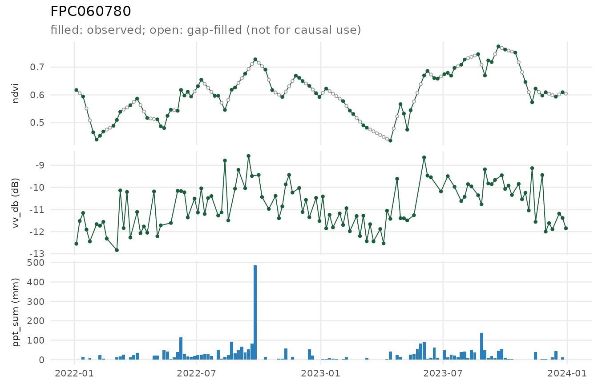
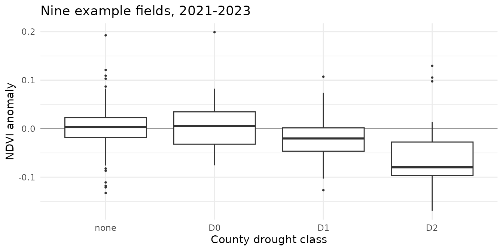

# Getting started with fpcubeR

This vignette walks through a typical analysis of the Florida Pasture
Cube:

1.  choose fields;
2.  read their 5-day series;
3.  look at a field;
4.  relate its greenness to drought;
5.  find the validation and benchmark tables.

It uses the small real extract shipped with the package, which holds
nine fields from Hardee, DeSoto and Highlands counties. With the full
data downloaded by
[`fpc_download()`](https://hugomachadorodrigues.github.io/fpcubeR/reference/fpc_download.md),
drop the `dir = d` arguments.

``` r

library(fpcubeR)
d <- fpc_example_dir()
```

## 1. Choose fields

[`fpc_fields()`](https://hugomachadorodrigues.github.io/fpcubeR/reference/fpc_fields.md)
returns the fields as an `sf` object in EPSG:5070. The tiers differ in
how sure we are that a field is grazed:

- **A:** fields on parcels coded as grazing land.
- **B:** fields on other parcels that were mapped as pasture in nearly
  every year.
- **C:** open pasture in the official land-use maps that the Cropland
  Data Layer maps as woody or wetland.

``` r

f <- fpc_fields(dir = d)
table(f$tier)
#> 
#> A B C 
#> 3 3 3
f[, c("field_id", "tier", "county", "area_ha", "hand_mean_m")]
#> Simple feature collection with 9 features and 5 fields
#> Geometry type: POLYGON
#> Dimension:     XY
#> Bounding box:  xmin: 1386915 ymin: 555975 xmax: 1487055 ymax: 609495
#> Projected CRS: NAD83 / Conus Albers
#>    field_id tier    county area_ha hand_mean_m                       geometry
#> 1 FPC059432    B    Hardee    8.28   8.0297442 POLYGON ((1392525 609495, 1...
#> 2 FPC060780    A    Hardee   16.65   0.9626154 POLYGON ((1387455 605895, 1...
#> 3 FPC061123    A    Hardee   10.53   0.6225764 POLYGON ((1391325 604905, 1...
#> 4 FPC061831    B    Hardee   34.83   1.1661365 POLYGON ((1391475 601725, 1...
#> 5 FPC062581    B    Hardee   20.97   0.8724991 POLYGON ((1393035 599535, 1...
#> 6 FPC062877    A    Hardee  115.74   1.7260204 POLYGON ((1390095 597435, 1...
#> 7 FPC094408    C Highlands   15.48   0.5854164 POLYGON ((1486815 581205, 1...
#> 8 FPC094588    C    DeSoto   14.94   1.2259987 POLYGON ((1387515 576585, 1...
#> 9 FPC095347    C    DeSoto   49.95   1.0317036 POLYGON ((1417245 557295, 1...
```

Filters can be combined, and `geometry = FALSE` returns a plain data
frame:

``` r

fpc_fields(tier = c("A", "B"), county = "Hardee", geometry = FALSE, dir = d)[, c("field_id", "tier")]
#>    field_id tier
#> 1 FPC059432    B
#> 2 FPC060780    A
#> 3 FPC061123    A
#> 4 FPC061831    B
#> 5 FPC062581    B
#> 6 FPC062877    A
```

## 2. Read the series

[`fpc_composites()`](https://hugomachadorodrigues.github.io/fpcubeR/reference/fpc_composites.md)
reads one row per field and 5-day period. Gap-filled optical values are
set to `NA` unless you ask for them with `observed_only = FALSE`. They
are built from the next observation, so they must not enter forecasts or
other causal analyses.

``` r

x <- fpc_composites(f, vars = c("ndvi", "vv_db", "ppt_sum"), years = 2022, dir = d)
head(x)
#>    field_id   fid       date      ndvi     vv_db ppt_sum n_optical_obs
#> 1 FPC059432 59432 2022-01-04 0.5673187       NaN  0.0000             2
#> 2 FPC059432 59432 2022-01-09        NA -11.51026  0.0000             0
#> 3 FPC059432 59432 2022-01-14 0.5754479       NaN 13.9515             2
#> 4 FPC059432 59432 2022-01-19        NA -12.71441  0.4209             0
#> 5 FPC059432 59432 2022-01-24        NA       NaN  9.8918             0
#> 6 FPC059432 59432 2022-01-29 0.3857892       NaN  0.0000             2
#>   gap_filled n_radar_obs
#> 1      FALSE           0
#> 2       TRUE           1
#> 3      FALSE           0
#> 4       TRUE           1
#> 5       TRUE           0
#> 6      FALSE           0
mean(!is.na(x$ndvi))   # share of field-periods with an observed NDVI
#> [1] 0.5540335
```

[`fpc_variables()`](https://hugomachadorodrigues.github.io/fpcubeR/reference/fpc_variables.md)
documents every variable:

``` r

v <- fpc_variables(d)
v[v$group %in% c("radar", "weather"), c("name", "units", "description")]
#>           name units
#> 17       vv_db    dB
#> 18       vh_db    dB
#> 19    vh_vv_db    dB
#> 20     ppt_sum    mm
#> 21  tmean_mean  degC
#> 22   tmin_mean  degC
#> 23   tmax_mean  degC
#> 24 vpdmax_mean   hPa
#>                                                                                                         description
#> 17                   Sentinel-1 RTC gamma0 VV, mean in linear power over the period's acquisitions, converted to dB
#> 18 Sentinel-1 RTC gamma0 VH, mean in linear power over the period's dual-polarisation acquisitions, converted to dB
#> 19                                                                                          VH minus VV backscatter
#> 20                                                                         PRISM precipitation, sum over the period
#> 21                                                               PRISM mean daily temperature, mean over the period
#> 22                                                            PRISM minimum daily temperature, mean over the period
#> 23                                                            PRISM maximum daily temperature, mean over the period
#> 24                                                PRISM maximum daily vapour pressure deficit, mean over the period
```

## 3. Look at a field

``` r

fpc_plot_field("FPC060780", vars = c("ndvi", "vv_db", "ppt_sum"), years = 2022:2023, dir = d)
```



The open circles are gap-filled values, drawn only to show the seasonal
course. The per-acquisition records behind the composites are in
[`fpc_observations()`](https://hugomachadorodrigues.github.io/fpcubeR/reference/fpc_observations.md):

``` r

o <- fpc_observations("optical", fields = "FPC060780", years = 2022, dir = d)
nrow(o)
#> [1] 93
table(o$sensor)
#> 
#> L30 S30 
#>  36  57
```

## 4. Greenness and drought

[`fpc_anomaly()`](https://hugomachadorodrigues.github.io/fpcubeR/reference/fpc_climatology.md)
compares each value with the field’s own climatology for the same time
of year, and
[`fpc_add_drought()`](https://hugomachadorodrigues.github.io/fpcubeR/reference/fpc_add_drought.md)
adds the county drought class valid on each date.

``` r

x3 <- fpc_composites(f, vars = "ndvi", dir = d)
a <- fpc_add_drought(fpc_anomaly(x3, "ndvi", ref_years = 2021:2022, min_years = 2), dir = d)
aggregate(anomaly ~ usdm_class, a, function(z) round(median(z), 3))
#>   usdm_class anomaly
#> 1          0   0.003
#> 2          1   0.006
#> 3          2  -0.020
#> 4          3  -0.080
```

``` r

library(ggplot2)
a$drought <- factor(a$usdm_class, 0:5, c("none", "D0", "D1", "D2", "D3", "D4"))
ggplot(a[!is.na(a$anomaly), ], aes(drought, anomaly)) +
  geom_hline(yintercept = 0, colour = "grey60") +
  geom_boxplot(outlier.size = 0.5) +
  labs(x = "County drought class", y = "NDVI anomaly", title = "Nine example fields, 2021-2023") +
  theme_minimal()
```



## 5. Validation and benchmark tables

The release also holds the tables behind the validation and the
benchmark of the paper, and the link of every field to version 1.0. For
example, the ESA WorldCover cover of the fields and the scores of task
1:

``` r

w <- fpc_validation("worldcover_by_field", fields = f, dir = d)
w[, c("field_id", "grassland", "tree", "herbaceous_wetland")]
#>    field_id grassland        tree herbaceous_wetland
#> 1 FPC059432 0.8293371 0.170662938        0.000000000
#> 2 FPC060780 0.8273428 0.074872327        0.000000000
#> 3 FPC061123 0.7844978 0.215502236        0.000000000
#> 4 FPC061831 0.8237267 0.176273288        0.000000000
#> 5 FPC062581 0.7203107 0.278993340        0.000000000
#> 6 FPC062877 0.9260253 0.071149163        0.002825567
#> 7 FPC094408 0.9471616 0.001148086        0.000000000
#> 8 FPC094588 0.9887424 0.011257614        0.000000000
#> 9 FPC095347 0.9971499 0.002850092        0.000000000
r <- fpc_benchmark("task1_results", dir = d)
r[r$split == "test" & r$horizon_days == 30, c("model", "rmse", "skill_vs_ref")]
#>         model       rmse skill_vs_ref
#> 5 persistence 0.10233533  -0.06090951
#> 6 climatology 0.09935425   0.00000000
#> 7    lightgbm 0.07424492   0.44158048
#> 8 transformer 0.07352084   0.45241940
```

[`fpc_lineage()`](https://hugomachadorodrigues.github.io/fpcubeR/reference/fpc_lineage.md),
[`fpc_validation()`](https://hugomachadorodrigues.github.io/fpcubeR/reference/fpc_validation.md)
and
[`fpc_benchmark()`](https://hugomachadorodrigues.github.io/fpcubeR/reference/fpc_benchmark.md)
without a table name list what is available.

## Working with the full data set

``` r

fpc_download(c("fields", "composites", "labels"))   # about 2.4 GB
fpc_download("optical")                              # per-acquisition HLS records, 4 GB
fa <- fpc_fields(tier = "A")
x <- fpc_composites(fa, vars = c("ndvi", "ppt_sum"), from = "2022-01-01", to = "2023-12-31")
```

Reading all fields for one year gives about 4.6 million rows. Select the
fields and variables you need, and the readers then load only those
parts of the files.
